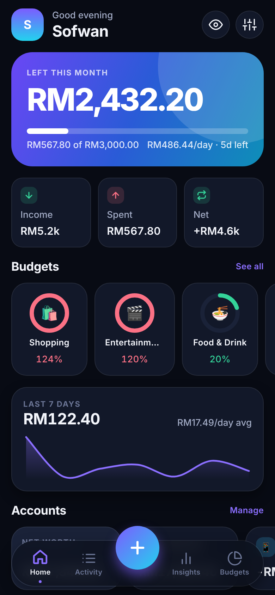
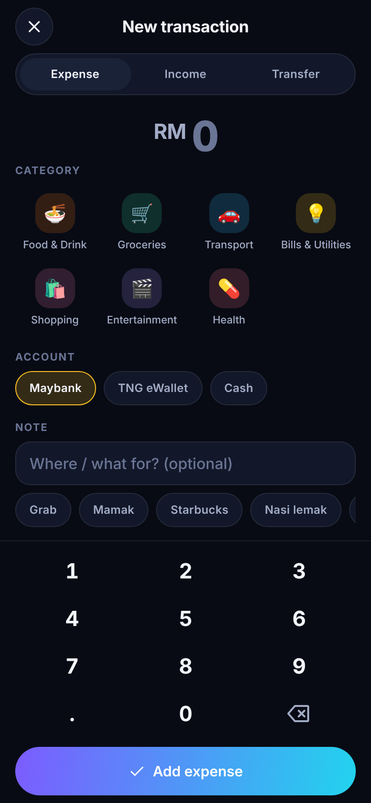
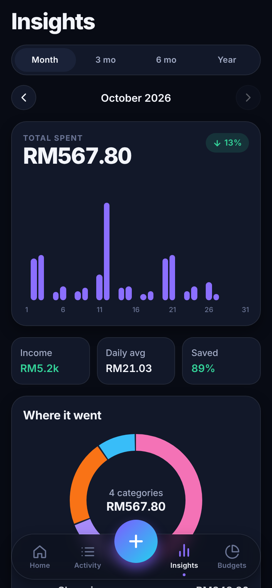
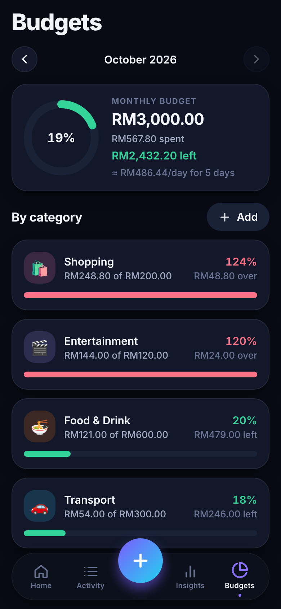

# Tally

A fast, private spending tracker for iOS and Android. Built with Expo (React Native) and TypeScript. Data lives on the device in an encrypted SQLite database. No account, no cloud, no analytics.

| Home | Add | Insights | Budgets |
|---|---|---|---|
|  |  |  |  |

## Features (Phase 1)

- **Quick add**: custom keypad, category grid, remembered account, one-tap suggestions from your frequent notes. Expense, income and transfer.
- **Activity**: grouped by day, search, month navigation, filters (type, account, category), swipe to delete with undo.
- **Budgets**: overall monthly budget plus per-category budgets, progress rings, amber at 80%, red when exceeded, safe-to-spend per day.
- **Insights**: month / 3 / 6 / 12-month views, animated bar chart you can scrub, category donut, change vs the previous period, savings rate, top spots, no-spend days.
- **Accounts**: cash, bank, card, e-wallet, savings, with balances and transfers. Debt (negative balances) supported.
- **Categories**: 16 expense + 7 income defaults, fully editable. Used items are archived, never deleted, so history stays correct.
- **Bank statement import (CSV)**: column auto-detection, DD/MM, MM/DD or ISO dates, debit/credit or signed amounts, auto-categorisation tuned for Malaysian merchants, duplicate-safe re-imports.
- **Export and backup**: CSV export, JSON backup, validated restore.
- **Privacy and security**: Face ID / fingerprint / passcode lock, app-switcher cover, optional screenshot blocking, "hide amounts" mode.
- **Design**: dark-first with a light theme, spring animations, haptics, floating glass tab bar.

## Run it

```bash
npm install
npx expo start --web        # quick UI preview in the browser (data is NOT encrypted here)
```

On a phone, build a development client. **Expo Go is not enough** because database encryption needs SQLCipher, which Expo Go does not ship:

```bash
npx expo run:android        # or: npx expo run:ios (macOS)
# or in the cloud:  npx eas-cli@latest build --profile development --platform android
```

Settings → Security shows whether the database is really encrypted (it checks `PRAGMA cipher_version`; it never assumes).

## Quality checks

```bash
npm run typecheck
npx eslint src
npm test                    # unit tests: money, dates, stats, CSV, import, backup validation
```

## Architecture

```
src/
  app/        Expo Router screens (tabs: Home, Activity, Insights, Budgets; modals: add, edit screens)
  components/ UI kit, charts (SVG + Reanimated), app lock, toasts
  db/         Repository: SQLCipher SQLite on native (index.ts), localStorage preview on web (index.web.ts)
  lib/        Pure logic with unit tests: money, dates, stats, periods, csv, importer, backup
  store/      Zustand store: all reads in memory, writes persisted first
  theme/      Design tokens, light/dark
```

Key decisions:

- **Money is integer sen**, never floats. `19.99` is exactly `1999`.
- **Dates are local `YYYY-MM-DD` strings**, so there are no timezone shifts.
- **Only bound SQL parameters**; table and column names come from fixed whitelists.
- The 256-bit database key is generated on first launch and stored only in the Keychain / Android Keystore (this-device-only). Android auto-backup is disabled so the file can't be restored without its key.
- Backup files are validated field by field (types, ranges, referential integrity) and can never switch off the app lock.
- CSV exports neutralise spreadsheet formula injection (`=`, `+`, `-`, `@`).

## Bank connection

Live bank sync is **not** in Phase 1. Malaysian banks have no consumer open-banking API yet, so it needs a licensed aggregator (for example Finverse or Brankas) plus a small backend that holds the tokens, because bank credentials must never live in the app. Until then, CSV statement import covers it.

## Roadmap

- **Phase 2**: bank sync via aggregator, recurring bills and subscriptions with reminders, savings goals, receipt OCR, multi-currency, split transactions.
- **Phase 3**: home-screen widgets, shared budgets, AI summaries.
