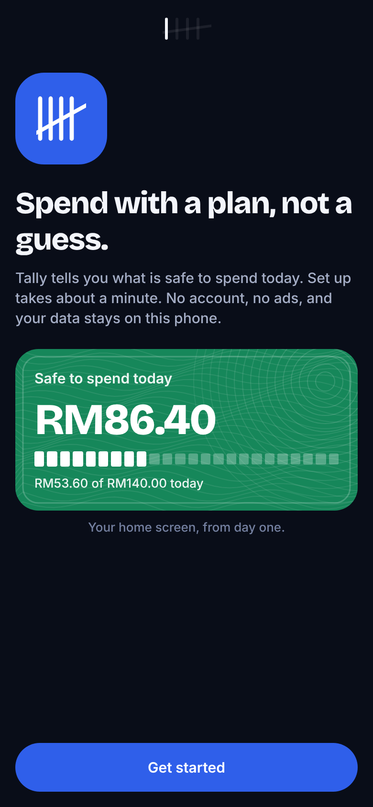
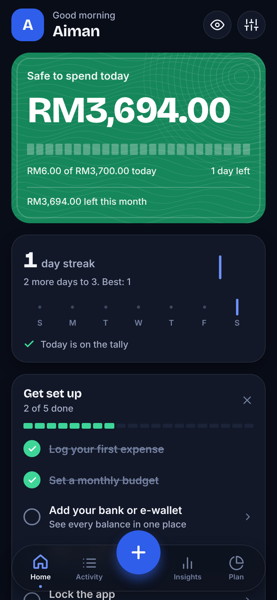
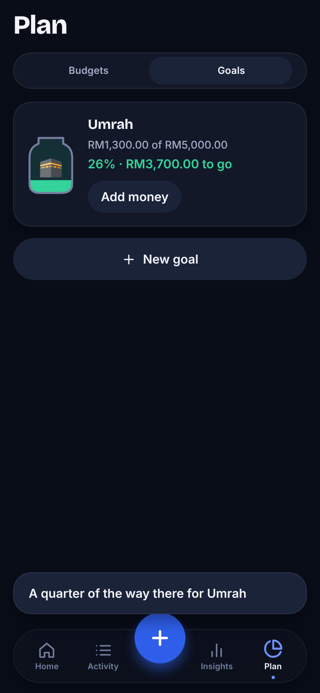
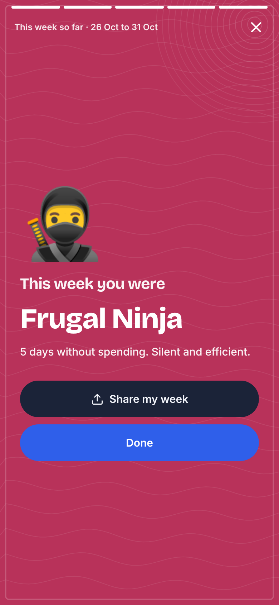

# Tally

A private spending tracker for iOS and Android, built around one question: **what is safe to spend today?**
Expo (React Native) and TypeScript. Data lives on the device in an encrypted SQLite database. No account, no cloud, no ads.

| First run | Home | Log | Goals | Weekly recap |
|---|---|---|---|---|
|  |  |  |  |  |

## Why it works the way it does

A ledger asks people to do work and gives nothing back, so they stop. Tally is designed around conversion (install to first log) and retention (a reason to open it tomorrow).

| Problem | Mechanism |
|---|---|
| Blank-slate friction | Onboarding builds a budget from your income and goal, then logs a first expense in one tap |
| "What can I spend?" is the real question | **Daily allowance** on Home: (budget - spent so far - bills still due) / days left. A bad day lowers tomorrow's number instead of silently breaking the month |
| Logging is a chore | Repeat chips log your usual spends in one tap; calculator keypad (`8.50+3`); categories ordered by use; an instant reward line after every log ("RM41 left today") |
| No reason to come back | **Tally-mark streak** (strokes in groups of five), no-spend-day check-in, milestone moments |
| Data you never look at | Plain-language insights, auto-detected repeating bills, a swipeable weekly recap with a spending "personality" |
| Long-term motivation | Savings **goals** as filling jars with milestone moments |
| Out of sight, out of mind | Local reminders: an evening nudge only if you have not logged, weekly recap, bill reminders. Permission is asked when you turn one on, never at launch. No amounts in notifications |

The look comes from the ringgit notes: the daily-allowance card changes colour like a different note (RM5 green when safe, RM20 orange when tight, RM10 red when over) and carries a banknote's fine wave-line print. Bricolage Grotesque carries headlines and numbers; Inter keeps body text quiet.

## Features

- **Home**: allowance, streak, one-tap repeats, insights, upcoming bills, setup checklist, budgets, accounts, recent activity
- **Quick add**: keypad with sums, category grid, remembered account, suggestions from your frequent notes, expense / income / transfer
- **Activity**: grouped by day, search, filters, swipe to delete with undo
- **Plan**: budgets (overall and per category) and goals
- **Insights**: month to year views, scrubbable chart, category donut, change vs previous period, repeating payments
- **Bank statement import (CSV)**, **CSV export**, **JSON backup and validated restore**
- **Security**: encrypted database (SQLCipher), biometric lock, app-switcher cover, optional screenshot blocking, hide-amounts mode
- Light and dark themes, spring motion that respects reduced-motion, haptics

## Run it

```bash
npm install
npx expo start --web        # browser preview (data is NOT encrypted there)
```

On a phone, build a development client. **Expo Go is not enough**: database encryption needs SQLCipher and reminders need a native module.

```bash
npx expo run:android        # or: npx expo run:ios (macOS)
# or in the cloud:  npx eas-cli@latest build --profile preview --platform android
```

Settings > Security shows whether the database is really encrypted (it checks `PRAGMA cipher_version`).

## Quality checks

```bash
npm run typecheck
npx eslint src
npm test                    # 36 unit tests: money, dates, stats, CSV, import, backup, allowance, streaks, recurring, insights, recap, goals, reminders
npx expo export --platform web && npm run e2e   # 32 browser checks of the main flows
```

## Architecture

```
src/
  app/         Expo Router screens (tabs: Home, Activity, Insights, Plan; modals: add, goals, budgets, accounts, categories; recap)
  components/  UI kit, charts, tally marks, banknote card, confetti, app lock
  db/          SQLCipher SQLite on native (index.ts); localStorage preview on web (index.web.ts); versioned migrations
  lib/         Pure, unit-tested logic (everything that decides what the user sees)
  reminders/   Local notifications, loaded lazily so a failure can never block app start
  store/       Zustand store; writes are persisted before state changes
  theme/       Tokens: ringgit-note palette, light and dark
```

Decisions worth knowing:

- Money is integer sen, never floats. Dates are local `YYYY-MM-DD` strings.
- Detected bills need a steady price (5% for two months, 15% from three) on about the same day each month, so a pharmacy visit is not a subscription.
- Imported and sample transactions never count toward the streak or the setup checklist.
- Backups are validated field by field and can never switch off the app lock.
- Notification text never contains amounts (it shows on the lock screen).

## Bank connection

Live bank sync is not built. Malaysian banks have no consumer open-banking API yet, so it needs a licensed aggregator (for example Finverse or Brankas) plus a small backend that holds the tokens. CSV statement import covers it for now.

## Roadmap

- Bank sync via an aggregator, receipt OCR, multi-currency, split transactions
- Home-screen widgets, shared budgets, AI summaries
